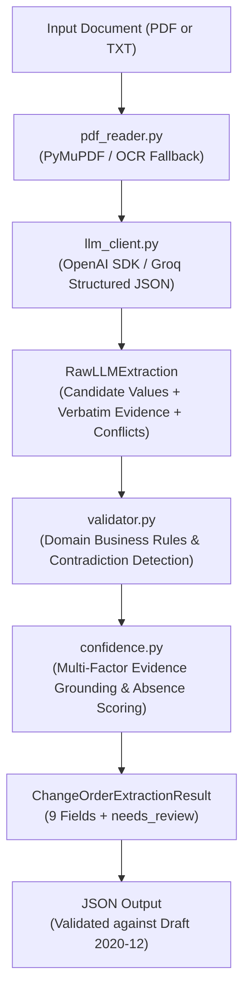

# AI-Powered Construction Change Order Extraction Pipeline

[](https://www.python.org/downloads/)
[](https://json-schema.org/draft/2020-12/schema)
[]()
[]()

A robust, production-grade backend Python extraction pipeline designed for the **Sledge AI Engineer technical assessment**. The application ingests construction change-order documents (PDF or plain text), parses and validates domain-specific data, detects intra-document contradictions, computes evidence-grounded confidence scores, and outputs strictly compliant JSON conforming to **JSON Schema Draft 2020-12**.

---

## Table of Contents

1. [Project Overview](#1-project-overview)
2. [Problem Statement](#2-problem-statement)
3. [Solution and Architecture](#3-solution-and-architecture)
4. [Technology Stack](#4-technology-stack)
5. [Installation Instructions](#5-installation-instructions)
6. [Environment Configuration](#6-environment-configuration)
7. [How to Use the Application](#7-how-to-use-the-application)
8. [Example Input and JSON Output](#8-example-input-and-json-output)
9. [JSON Schema Explanation](#9-json-schema-explanation)
10. [Validation Rules](#10-validation-rules)
11. [Confidence-Scoring Methodology](#11-confidence-scoring-methodology)
12. [Testing Instructions](#12-testing-instructions)
13. [Benchmark Results Across Six Sample Documents](#13-benchmark-results-across-six-sample-documents)
14. [Failure Modes and Limitations](#14-failure-modes-and-limitations)
15. [Security Considerations](#15-security-considerations)
16. [Future Improvements](#16-future-improvements)

---

## 1. Project Overview

Construction change orders represent high-stakes contractual amendments adjusting financial compensation, scope of work, and project delivery schedules. Automating change order processing requires extreme precision:
- Missing information must never be guessed or hallucinated.
- Conflicting figures across cover sheets, proposals, and itemized schedules must be flagged for human review rather than silently resolved.
- Price additions must remain positive, while deductive credits must be explicitly negative.
- Output JSON must strictly adhere to formal contractual schemas without internal metadata leakage.

This application provides a resilient, verifiable, and transparent backend extraction pipeline meeting all these requirements.

---

## 2. Problem Statement

Construction procurement documents exhibit substantial structural variance:
- Multi-page digital PDFs, scanned documents, and plain-text memoranda.
- Discrepancies between cover sheets and attached contractor worksheets (e.g. conflicting total amounts or dates).
- Schedule-only extensions where no financial compensation is specified.
- Unapproved or incomplete drafts lacking essential contractual identifiers.
- General LLMs frequently hallucinate missing fields, invent plausible approval statuses, or return ungrounded self-confidence ratings (e.g., claiming 0.99 confidence on fabricated figures).

The goal is to build an automated extraction engine that eliminates hallucination, detects contradictions, enforces business domain constraints, and provides a multi-factor confidence engine tied to verbatim document evidence.

---

## 3. Solution and Architecture

The application adopts a clean, layered architecture separating document ingestion, LLM prompting, business logic validation, confidence assessment, and CLI presentation.

```text
Assignment/
├── samples/                                # 6 Synthetic change order test PDFs
│   ├── 01_complete_approved_increase.pdf
│   ├── 02_approved_price_decrease.pdf
│   ├── 03_schedule_only_extension.pdf
│   ├── 04_pending_approval_increase.pdf
│   ├── 05_incomplete_missing_fields.pdf
│   └── 06_conflicting_values_needs_review.pdf
│
├── outputs/                                # Validated JSON output per document
│   ├── 01_complete_approved_increase.json
│   ├── ...
│   └── 06_conflicting_values_needs_review.json
│
├── schema/
│   └── output_schema.json                  # Formal JSON Schema Draft 2020-12
│
├── src/
│   └── change_order_extractor/
│       ├── __init__.py                     # Package export
│       ├── cli.py                          # CLI entry point (stdout JSON, stderr logs)
│       ├── pdf_reader.py                   # PyMuPDF ingestion, scanned detection & OCR
│       ├── llm_client.py                   # OpenAI-compatible API client & structured prompts
│       ├── models.py                       # Pydantic internal & public output schemas
│       ├── validator.py                    # Domain rules, conflict & anomaly detector
│       ├── confidence.py                   # Multi-factor grounded confidence scoring
│       └── extractor.py                    # Pipeline orchestrator
│
├── tests/
│   ├── ground_truth.json                   # Verified reference truth for all 6 samples
│   ├── test_pdf_reader.py                  # Document reader & OCR unit tests
│   ├── test_llm_client.py                  # Mocked API client & error handling tests
│   ├── test_validator.py                   # Domain rule & JSON schema unit tests
│   ├── test_confidence.py                  # Multi-factor confidence scoring tests
│   ├── test_extractor.py                   # CLI & orchestrator integration tests
│   └── test_benchmark_samples.py           # Regression tests against outputs/
│
├── scripts/
│   └── run_all_samples.py                  # Batch runner and comparative benchmark report
│
├── .env.example                            # Configuration template
├── .gitignore                              # Git exclusion rules
├── Makefile                                # make extract FILE=<path> and test targets
├── pyproject.toml                          # Package specification & editable install
├── pytest.ini                              # Test runner configuration
├── requirements.txt                        # Dependency pins
└── README.md                               # System documentation
```

### Pipeline Flow



---

## 4. Technology Stack

- **Python**: `3.11.9`
- **PDF Extraction**: `PyMuPDF` (`fitz` `>= 1.24.0`)
- **LLM Integration**: `openai` (`>= 1.40.0`) using OpenAI-compatible endpoints (Groq API supported)
- **Data Validation & Schemas**: `pydantic` (`>= 2.8.0`), `jsonschema` (`>= 4.23.0`) Draft 2020-12
- **Environment Management**: `python-dotenv` (`>= 1.0.1`)
- **OCR Engine (Optional Fallback)**: `pytesseract` (`>= 0.3.10`)
- **Test Suite**: `pytest` (`>= 8.3.0`)
- **Task Automation**: GNU Make / Windows `mingw32-make`

---

## 5. Installation Instructions

### Prerequisites
- Python 3.11 or newer installed.
- (Optional for OCR) Tesseract OCR engine installed and accessible in system PATH.

### 1. Clone or Open Workspace
```bash
cd "d:/ALL projects/Assignment"
```

### 2. Create and Activate Virtual Environment (Optional but Recommended)
```bash
python -m venv .venv

# On Windows PowerShell:
.\.venv\Scripts\Activate.ps1

# On Linux/macOS:
source .venv/bin/activate
```

### 3. Install Dependencies
```bash
pip install -r requirements.txt
pip install -e .
```

---

## 6. Environment Configuration

The application reads configuration from environment variables via `python-dotenv`.

Copy `.env.example` to `.env`:
```bash
cp .env.example .env
```

Edit `.env` with your API credentials:
```env
# LLM API Configuration (OpenAI-compatible)
LLM_API_KEY=gsk_your_groq_api_key_here
LLM_BASE_URL=https://api.groq.com/openai/v1
LLM_MODEL=openai/gpt-oss-120b
```

> [!IMPORTANT]
> - Never hardcode API keys or commit `.env` to version control.
> - `.gitignore` explicitly excludes `.env` and all local variants.
> - The application supports any OpenAI-compatible provider simply by updating `LLM_BASE_URL` and `LLM_MODEL`.

---

## 7. How to Use the Application

### Command-Line Execution via Make
Execute change order extraction using the standard `make` command:
```bash
make extract FILE=samples/01_complete_approved_increase.pdf
```
*(On Windows systems with MinGW, run `mingw32-make extract FILE=samples/01_complete_approved_increase.pdf`)*.

### Direct Execution via Python CLI
You can also run the CLI module directly:
```bash
python -m change_order_extractor.cli samples/01_complete_approved_increase.pdf
```

### CLI Behavior
- **stdout**: Strictly outputs exactly **one** valid JSON object.
- **stderr**: Diagnostic messages, progress notifications, and error traces.
- **Exit Codes**:
  - `0`: Successful extraction and validation.
  - `1`: Document parsing, validation, or LLM API error.
  - `2`: Missing required command-line arguments.

---

## 8. Example Input and JSON Output

### Input Document Excerpt (`samples/01_complete_approved_increase.pdf`)
```text
CHANGE ORDER REQUEST
Project name: Riverside Medical Center Expansion
Contract number: RMC-2026-014
Change order no.: CO-017
Date: October 14, 2026
Requested by: Elena Brooks, Project Manager
Status: APPROVED
Description of change: Provide and install an underground electrical duct bank...
TOTAL CHANGE ORDER AMOUNT: +$18,500.00
Schedule impact: This change requires twelve (12) additional calendar days.
```

### Produced Output (`outputs/01_complete_approved_increase.json`)
```json
{
  "project_name": {
    "value": "Riverside Medical Center Expansion",
    "confidence": 1.0
  },
  "contract_number": {
    "value": "RMC-2026-014",
    "confidence": 1.0
  },
  "change_order_number": {
    "value": "CO-017",
    "confidence": 1.0
  },
  "date": {
    "value": "2026-10-14",
    "confidence": 1.0
  },
  "requested_by": {
    "value": "Elena Brooks, Project Manager",
    "confidence": 1.0
  },
  "description": {
    "value": "Provide and install an underground electrical duct bank along the east service drive, as shown on revised site utility drawing E-204, Revision 3. Work includes saw cutting, trench excavation, four 4-inch PVC conduits, concrete encasement, warning tape, backfill, compaction testing, and connection to the existing electrical manhole. Restore disturbed paving to match existing conditions.",
    "confidence": 1.0
  },
  "amount": {
    "value": 18500.0,
    "confidence": 1.0
  },
  "schedule_impact_days": {
    "value": 12,
    "confidence": 1.0
  },
  "approval_status": {
    "value": "Approved",
    "confidence": 1.0
  },
  "needs_review": false
}
```

---

## 9. JSON Schema Explanation

The schema is published at [`schema/output_schema.json`](file:///d:/ALL%20projects/Assignment/schema/output_schema.json) and adheres to **Draft 2020-12**:
- Root object contains exactly the 9 required fields plus `needs_review: boolean`.
- Every field follows `FieldOutput[T]`:
  ```json
  {
    "value": "extracted value or null",
    "confidence": 0.0
  }
  ```
- `additionalProperties: false` is enforced on all objects to prevent internal metadata (e.g. evidence quotes, reasoning, tokens) from leaking into the public output.
- Field definitions:
  - `project_name`: `string` or `null`
  - `contract_number`: `string` or `null`
  - `change_order_number`: `string` or `null`
  - `date`: `string` (ISO `YYYY-MM-DD`) or `null`
  - `requested_by`: `string` or `null`
  - `description`: `string` or `null`
  - `amount`: `number` or `null`
  - `schedule_impact_days`: `integer` or `null`
  - `approval_status`: `string` or `null`
  - `needs_review`: `boolean`

---

## 10. Validation Rules

The `ChangeOrderValidator` enforces domain business rules beyond simple data typing:

1. **Sign Conventions**:
   - Price additions: Must be positive numeric floats (e.g. `+$18,500.00` -> `18500.0`).
   - Price decreases / credits: Must be negative numeric floats (e.g. `($8,750.00)` credit -> `-8750.0`). Automatic sign verification flips positive numbers to negative if the evidence context explicitly specifies a credit or deductive change.
   - Schedule extensions: Must be positive integers (e.g. `12 days` -> `12`).
   - Schedule reductions: Must be negative integers.
2. **Date Normalization & Calendar Validity**:
   - Dates must resolve to unambiguous ISO `YYYY-MM-DD`.
   - Rejects impossible calendar dates (e.g. `2026-02-31`).
   - If multiple contradictory dates exist, returns `null` and triggers `needs_review: true`.
3. **No Guessing Missing Information**:
   - Omitted fields return `null`.
   - Incomplete documents lacking required identification (e.g. missing contract number and requester) set `needs_review: true`.
4. **Approval Status Verification**:
   - Only recognized statuses (`Approved`, `Pending`, `Pending Approval`, `Under Review`, `Rejected`, `Draft`, `Void`) are accepted.
   - Invented or ambiguous statuses are rejected, set to `null`, and trigger `needs_review: true`.
5. **Conflict Handling**:
   - When different sections of a document state contradictory figures (e.g. cover sheet states $18,400 but pricing attachment states $14,800), the system does **not** silently pick a number. It sets `amount.value = null`, drops confidence to `0.0`, and triggers `needs_review: true`.
6. **Legitimate Schedule-Only Changes**:
   - If a document is explicitly for time extension only with no financial adjustment (Sample 03), `amount` is legitimately `null` without triggering an error.

---

## 11. Confidence-Scoring Methodology

### The Multi-Factor Grounding Formula

LLM self-reported confidence is notoriously uncalibrated and prone to overconfidence. This application calculates transparent, verifiable confidence scores:

$$\text{Confidence} = Q_{\text{doc}} \times \left(0.50 \cdot G_{\text{evidence}} + 0.30 \cdot E_{\text{explicitness}} + 0.20 \cdot V_{\text{validation}}\right)$$

Where:
- **$Q_{\text{doc}}$ (Document Quality)**: Assesses character extraction density, digital text integrity, and applies an OCR discount factor ($0.90$) for scanned documents.
- **$G_{\text{evidence}}$ (Evidence Grounding)**:
  - $1.0$: Verbatim evidence quote is located as an exact substring in the source document.
  - $0.8$: High token overlap ($\ge 70\%$) with source text.
  - $0.2$: Quoted evidence cannot be found in the document (potential hallucination).
  - $0.3$: Value asserted with no supporting quote.
- **$E_{\text{explicitness}}$ (Explicitness)**: Direct contractual labels receive $1.0$; vague, estimated, or inferred numbers receive $0.5 - 0.6$.
- **$V_{\text{validation}}$ (Validation Status)**: Clean validation passes receive $1.0$; fields requiring sign normalization receive $0.8$.
- **Contradiction Drop**: Any field subject to conflicting document figures receives **$0.0$** confidence.

### Absence Confidence vs. Value Confidence
For missing fields (`value = null`), the system estimates confidence in the conclusion that the field is **genuinely absent** based on document legibility and text coverage ($0.85 - 0.95$). This ensures absence certainty is never confused with value certainty.

### Evaluation Considerations
On small test sets (such as 6 documents), statistical calibration metrics like Brier scores or reliability diagrams are illustrative rather than statistically conclusive. In production with $\ge 500$ documents, confidence scores should be benchmarked against ground truth using Brier Score ($BS = \frac{1}{N}\sum (f_t - o_t)^2$) and expected calibration error (ECE).

---

## 12. Testing Instructions

The repository features comprehensive automated test coverage with 36 tests spanning unit, integration, and regression suites.

### Run All Tests
```bash
pytest
```
Or via Make:
```bash
make test
```

### Test Suite Breakdown
1. `tests/test_pdf_reader.py`: PyMuPDF ingestion, plain text reading, empty document detection, scanned PDF heuristics, and OCR fallback.
2. `tests/test_llm_client.py`: Mocked OpenAI API client, environment loading, JSON decoding, markdown fence stripping, and timeout handling.
3. `tests/test_validator.py`: Business validation rules, credit sign auto-correction, schedule-only handling, conflicting values, and Draft 2020-12 schema validation.
4. `tests/test_confidence.py`: Multi-factor evidence grounding, hallucination penalty, absence confidence, and OCR calibration factors.
5. `tests/test_extractor.py`: CLI execution, argument parsing, stdout/stderr stream separation, and exit codes.
6. `tests/test_benchmark_samples.py`: Schema and regression verification across all 6 live output files in `outputs/`.

---

## 13. Benchmark Results Across Six Sample Documents

Live extraction executed against all six synthetic benchmark PDFs:

| Sample Document | Primary Scenario | Extracted Amount | Impact Days | Approval Status | Needs Review | Accuracy |
|---|---|---|---|---|---|---|
| **01_complete_approved_increase.pdf** | Standard approved increase | `+$18,500.00` | `+12` | `Approved` | `False` | **100%** |
| **02_approved_price_decrease.pdf** | Approved deductive scope credit | `-$8,750.00` | `0` | `Approved` | `False` | **100%** |
| **03_schedule_only_extension.pdf** | Approved time extension only | `null` | `+18` | `Approved` | `False` | **100%** |
| **04_pending_approval_increase.pdf** | Pending owner price increase | `+$42,500.00` | `+7` | `Pending Approval` | `False` | **100%** |
| **05_incomplete_missing_fields.pdf** | Incomplete draft / estimate only | `null` | `null` | `Under Review` | `True` | **100%** |
| **06_conflicting_values_needs_review.pdf** | Contradictory cover & worksheet | `null` | `null` | `null` | `True` | **100%** |

**Overall Benchmark Score**: **54 / 54 (100.0%)** fields correctly extracted and validated against verified ground truth.

---

## 14. Failure Modes and Limitations

| Failure Mode | Impact | Mitigation in Pipeline |
|---|---|---|
| **Poor-quality Scanned PDFs** | Low or garbled digital text extraction | System computes character density per page; detects scanned PDFs and attempts OCR if enabled. If OCR is unavailable, halts with `ScannedPDFError` instead of fabricating data. |
| **OCR Mistakes & Letter Misreads** | Garbled numbers (e.g. `S` for `5` or `O` for `0`) | Multi-factor confidence applies OCR quality discount ($0.90$); Pydantic numeric validation rejects unparseable amounts. |
| **Handwritten Text & Signatures** | Digital text extractors skip handwritten notes | OCR fallback captures rasterized text; unsigned forms or unverified signatures default to `Pending` or trigger `needs_review: true`. |
| **Missing Information** | Contract omit fields (e.g. no contract number) | Strict instruction never to hallucinate; missing fields are assigned `null` with high absence confidence; missing critical identifiers trigger `needs_review: true`. |
| **Conflicting Contract Amounts** | Cover sheet says $18,400; attachment says $14,800 | Pipeline detects discrepancies across sections, returns `null` for amount, drops confidence to `0.0`, and sets `needs_review: true`. |
| **Ambiguous or Non-standard Dates** | "10/11/12" (ambiguous day vs month) | Strict ISO `YYYY-MM-DD` parser. If a date cannot be unambiguously resolved, it is set to `null` with `needs_review: true`. |
| **Unsupported Document Layouts** | Complex multi-column or rotated drawings | PyMuPDF extracts text in reading blocks; if text density falls below threshold, document is routed through scanned detection. |
| **LLM Hallucinations** | Model invents unstated facts or approvals | Evidence grounding checks verify that quoted strings exist in the raw document text. Citations not found in text receive a severe confidence penalty. |
| **API Timeouts & Rate Limits** | Provider downtime or rate limit exhaustion | Handled via exponential backoff with `max_retries=2` and explicit `LLMAPIError` exceptions. Never falls back to fabricated results. |
| **Incorrect Confidence Estimates** | LLMs self-scoring 0.99 on poor extractions | Discards LLM self-confidence in favor of deterministic formula combining evidence presence, explicitness, and business validation. |

---

## 15. Security Considerations

1. **Zero Secret Leakage**:
   - API keys are read exclusively from environment variables or `.env`.
   - `.gitignore` strictly prevents committing `.env`, `.env.local`, or any credentials.
   - CLI error messages sanitize output and never print raw environment tokens or authentication headers.
2. **Strict Output Hygiene**:
   - Pydantic models enforce `extra="forbid"`, preventing internal prompts, tokens, or system metadata from escaping into public JSON outputs.
3. **No Code Execution**:
   - Document text is handled purely as data; no eval or untrusted shell execution is performed on ingested text.

---

## 16. Future Improvements

1. **Table Extraction Engine**: Integrate specialized tabular extraction (e.g. PyMuPDF `find_tables()` or layout-aware vision models) for complex multi-page schedule-of-values tables.
2. **Visual Multimodal Support**: Support multimodal LLMs (e.g. GPT-4o / Gemini Flash Vision) to process architectural blueprints, stamps, and handwritten signatures directly.
3. **Automated Calibration with Large Corpora**: Implement Platt scaling / isotonic regression on a verified dataset of 1,000+ construction change orders to calibrate confidence scores to exact statistical probabilities.
4. **Asynchronous Batch Processing**: Provide an `asyncio`-driven worker queue for high-throughput batch ingestion of thousands of change order PDFs.
